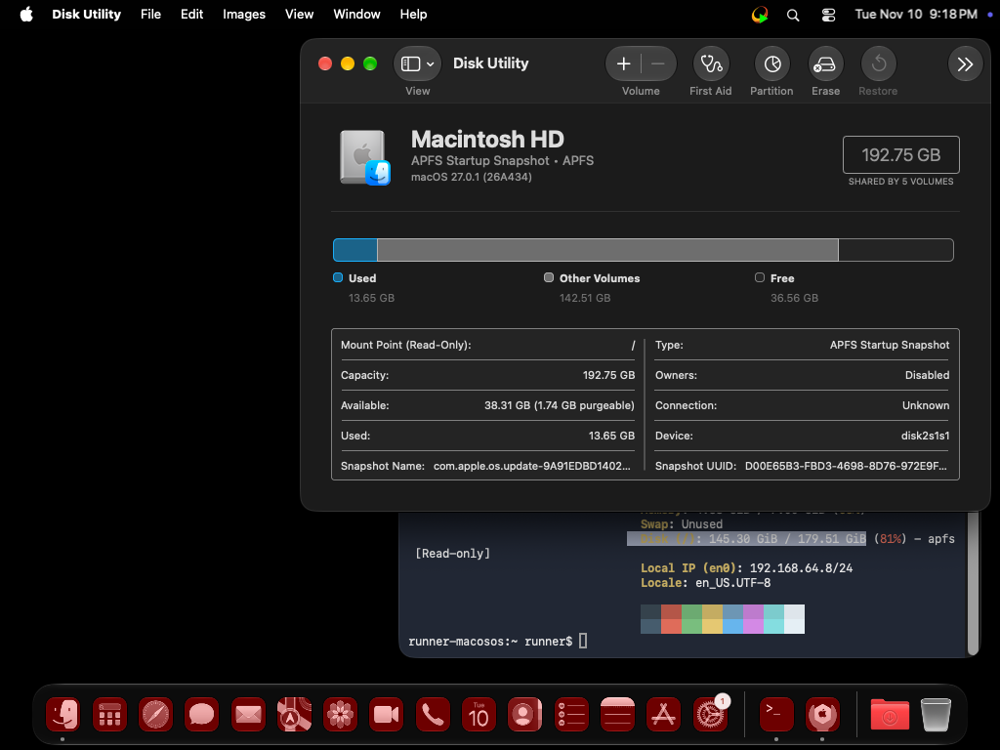
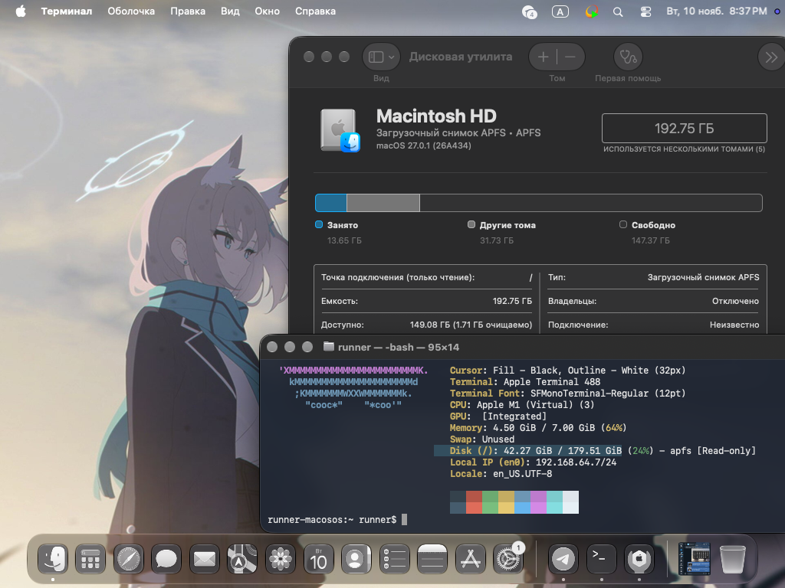

# 🧹 macOS Runner Debloater

Reclaim disk space on **GitHub-hosted macOS runners** in one step.
Choose which Xcode to keep (or none), and the action cleans Homebrew, simulators, the Android SDK,
the tool cache, Chrome/Edge, caches and more - while **never touching Tailscale or Sunshine/Apollo**.

GitHub-hosted macOS images ship with a lot of software, and the disk is almost full before your job even starts.
This action removes what you don't need so builds, streaming sessions and large downloads have room to breathe.

## Before / after

| Before | After |
|:---:|:---:|
|  |  |

## Integration in 3 steps

**1. Put the action in a repository.** Keep these files in the repo root:

```
macos-debloater/
├── action.yml
├── index.js
├── README.md
└── docs/
    ├── before.png
    └── after.png
```

Push to `main`, then publish a release tag so people can pin a version:

```bash
git tag -a v1 -m "v1" && git push origin v1
```

**2. Add it as the first step of your job.** Running it first means every later step already has the space.
No `actions/checkout` is needed when you reference it by `OWNER/repo@tag`.

```yaml
name: Build
on: [push, workflow_dispatch]

jobs:
  build:
    runs-on: macos-26            # macos-15 | macos-26 | macos-26-intel | xcode-27
    steps:
      - name: Free up disk space
        id: debloat
        uses: OWNER/macos-debloater@v1
        with:
          xcode: none            # remove every Xcode (see "Choosing your Xcode")

      - uses: actions/checkout@v4
      # ... the rest of your job ...

      - run: echo "Freed ${{ steps.debloat.outputs.freed-gb }} GiB"
```

**3. Try it safely first.** Run once with `dry-run: true`. Nothing is deleted; you get the plan,
the biggest folders on the disk and an estimate of what can be reclaimed. Then switch it off.

```yaml
        with:
          dry-run: true
```

### Using it from the same repository instead

Copy `action.yml` and `index.js` to e.g. `.github/actions/macos-debloater/` and call it with a checkout first:

```yaml
    steps:
      - uses: actions/checkout@v4
      - uses: ./.github/actions/macos-debloater
        with:
          xcode: none
```

## Which inputs do I actually need?

There are many inputs, but you will rarely use more than two. Everything has a sensible default.

**1. The one you will touch: `xcode`.**
It is the biggest item on the image. Pick `none` (remove all), a version (`27.2`), `latest`, `default` or `all` (leave alone).

**2. Your safety net: `dry-run`, `keep-paths`, `homebrew-keep`.**
`dry-run: true` shows the plan without deleting. If a job needs something the action would remove,
protect it with `keep-paths` / `homebrew-keep` instead of switching a whole category off.

**3. On/off toggles - leave on, switch off only if your job needs the thing.**
`simulators`, `android`, `dotnet`, `powershell`, `rust`, `browsers`, `homebrew`, `caches`, `misc`.
For example, building iOS apps? Keep Xcode and set `simulators: false`. Building Android apps? Set `android: false`.

**4. Fine-tuning - ignore unless you have a reason.**
`java-keep`, `toolcache-keep-latest`, `toolcache-remove`, `homebrew-remove`, `xcode-strip-platforms`.

**5. Diagnostics - leave alone.**
`report-sizes`, `analyze` (both are already on in dry-run), `disable-spotlight`.

### Ready-made recipes

```yaml
# Maximum cleanup (streaming, scripting, general CI)
- uses: OWNER/macos-debloater@v1
  with:
    xcode: none

# iOS/macOS app build: keep one Xcode, drop what you never build for
- uses: OWNER/macos-debloater@v1
  with:
    xcode: "27.2"
    xcode-strip-platforms: tvos,watchos,visionos
    android: false

# Android build on macOS: no Xcode, keep the Android SDK and JDK 17
- uses: OWNER/macos-debloater@v1
  with:
    xcode: none
    android: false
    java-keep: "17"

# Cautious: only look
- uses: OWNER/macos-debloater@v1
  with:
    dry-run: true
```

## Auto-detection

Nothing to configure per runner. The action detects the macOS version, the CPU architecture
(Apple silicon / Intel), the Homebrew prefix (`/opt/homebrew` or `/usr/local`), the installed Xcode versions and
the active `node` / `python3` by itself, and prints what it found at the top of the log.
The runner label is only your normal `runs-on`.

## Supported runners

| Label | Arch | Notes |
|---|---|---|
| `macos-15` | arm64 | Sequoia |
| `macos-26` | arm64 | |
| `macos-26-intel` | x86_64 | Slower, but works; Homebrew lives in `/usr/local` and is detected automatically |
| `xcode-27` | arm64 | macOS 27 |

Any runner with passwordless `sudo` should work. GitHub-hosted runners have it by default.

## Choosing your Xcode

| Value | Result |
|---|---|
| `default` | Keep the version `Xcode.app` points to, remove the rest |
| `latest` | Keep the newest installed version |
| `27.2`, `16.4`, `26.1`, ... | Keep exactly that version (`26.1` also matches `Xcode_26.1.1.app` through its symlink) |
| `none` | Remove every Xcode and switch `xcode-select` to the Command Line Tools |
| `all` | Leave Xcode completely untouched |

If the requested version is not installed, the action **fails before deleting anything** and lists what is available.
After removal, `/Applications/Xcode.app` and `xcode-select` are re-pointed to the version you kept.

> Do not combine this with a step that selects an Xcode version you just removed (for example `setup-xcode`).

## What gets cleaned

| Area | What happens | Toggle |
|---|---|---|
| Xcode | See above | `xcode`, `xcode-strip-platforms` |
| Simulators | Runtimes unmounted, then CoreSimulator, DerivedData and `~/Library/Developer` removed | `simulators` |
| Homebrew | Heavy formulae and casks removed (gcc, llvm, azure-cli, awscli, bazel, gradle, cocoapods, fastlane, Chrome, Edge, ...), old `node@N` / `python@X.Y` removed, then a guarded `autoremove` and `cleanup` | `homebrew`, `homebrew-remove`, `homebrew-keep` |
| Tool cache | Only the newest `Python` and `node` are kept; `Ruby`, `go`, `PyPy`, `CodeQL` removed | `toolcache-keep-latest`, `toolcache-remove` |
| Android | SDK, NDKs, emulator | `android` |
| Java | All JDKs except the one you keep (default 21) | `java-keep` |
| .NET / PowerShell / Rust | SDKs and toolchains | `dotnet`, `powershell`, `rust` |
| Browsers | Chrome, Edge, their drivers and Selenium | `browsers` |
| Caches | `~/Library/Caches`, `~/.npm`, `~/.gradle`, `~/.m2`, `~/.cache`, ... | `caches` |
| Misc | vcpkg, `~/image-generation`, `~/actionarchivecache` | `misc` |

## What is never touched

- **Tailscale** and **Sunshine / Apollo**: anything whose path or Homebrew name matches
  `tailscale`, `sunshine` or `apollo`, plus the Homebrew dependencies they need.
- **Safari and Firefox** (and `geckodriver`) always stay.
- The runner itself: `~/actions-runner`, `~/work`, `~/bootstrap`, `RUNNER_TEMP`, `GITHUB_WORKSPACE`.
- The `node` and `python3` that are currently active in `PATH`, and the newest `node` / `python` in Homebrew.
- Git, GitHub CLI, curl, jq, cmake, ninja, OpenSSL and other basics are not on any removal list.
- Anything you add to `keep-paths` or `homebrew-keep`.

## Outputs

| Output | Description |
|---|---|
| `freed-gb` | GiB freed, measured with `df` on the Data volume |
| `free-before-gb` | GiB free before cleaning |
| `free-after-gb` | GiB free after cleaning |

The job summary also contains a before/after table, the biggest wins per category and per-step timings.

## Full input reference

| Input | Default | Description |
|---|---|---|
| `xcode` | `default` | `default` \| `latest` \| a version \| `none` \| `all` |
| `xcode-strip-platforms` | `''` | `ios,tvos,watchos,visionos,driverkit` or `all` (everything except macOS) |
| `simulators` | `true` | Remove simulators, CoreSimulator, DerivedData |
| `android` | `true` | Remove the Android SDK/NDK |
| `java-keep` | `21` | JDK major version to keep; `none` removes all, `all` leaves them |
| `dotnet` | `true` | Remove .NET SDKs |
| `powershell` | `true` | Remove PowerShell |
| `rust` | `true` | Remove rustup and cargo |
| `browsers` | `true` | Remove Chrome, Edge, their drivers and Selenium (Safari and Firefox stay) |
| `homebrew` | `true` | Clean Homebrew |
| `homebrew-remove` | `''` | Extra Homebrew names/globs to uninstall, comma separated |
| `homebrew-keep` | `''` | Homebrew names/globs to never uninstall, comma separated |
| `toolcache-keep-latest` | `Python,node` | Tool cache folders where only the newest version is kept |
| `toolcache-remove` | `Ruby,go,PyPy,CodeQL` | Tool cache folders removed completely |
| `caches` | `true` | Clean caches |
| `misc` | `true` | Remove vcpkg and runner image leftovers |
| `disable-spotlight` | `true` | Disable Spotlight indexing for the run |
| `keep-paths` | `''` | Extra paths that must never be deleted, comma separated |
| `dry-run` | `false` | Delete nothing; print the plan with sizes |
| `report-sizes` | `false` | Measure each removed path (slower; always on in dry-run) |
| `analyze` | `false` | Print the biggest folders before cleaning (always on in dry-run) |

## How it works

1. **Plan first.** The Xcode selection is resolved before anything is deleted, so a typo cannot cause damage.
2. **Instant delete.** Each target is renamed (`mv`) into a hidden folder on the same APFS volume, which is instant.
   The real `rm -rf` then runs in the background with three workers, so a 60k-file Xcode bundle never blocks the other steps.
3. **Guarded Homebrew cleanup.** Removal is driven by an explicit list, and the dependency closure of the protected
   software is computed first. `brew autoremove` is run as a dry run and filtered through that protected set.
4. **Measured result.** Free space is read from `df` before and after, once the background deletion has finished.

## Requirements

- A macOS runner with passwordless `sudo` (the case on GitHub-hosted runners).
- `node` available in `PATH` (preinstalled on GitHub-hosted macOS images).

## FAQ

**Can it break my build?**
Only if your build needs something that was removed. The defaults are aggressive on purpose.
Run with `dry-run: true` first, then relax the toggles you need or protect specific things with
`homebrew-keep` and `keep-paths`.

**Why do the final numbers appear only at the end?**
Deletion runs in the background. The numbers are taken after every background task has completed.

## License

MIT
